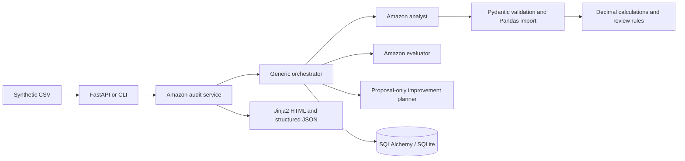

# Architecture

The first vertical slice is a single Python process and SQL database. The generic core is independent
of the first business. FastAPI and CLI are two entry points to the same application service.

`platform_core` owns task IDs, business IDs, input/output references, component identity, status,
start/completion timestamps, sanitized error types, estimated external execution cost, stage outputs
and evaluation metadata. `amazon_audit` supplies components and final report rendering. The service
passes a versioned workflow name and input SHA-256 to the core. A resume must match both and the
business ID. Stage completion checkpoints persist JSON, allowing a new process to skip previously
completed pure stages after a handled failure. Logs contain event/ID/type metadata, not source records.

The analyst imports and calculates; the evaluator checks row uniqueness, nonempty analysis,
recomputed formulas, summary reconciliation and evidence/approval markers; the improvement planner
proposes data-quality, inventory calibration and customer-validation work. Evaluation is a local
integrity gate, not a claim of market demand, accounting certification or real-world accuracy.
Independent numerical tests complement evaluator reuse of the production formulas.

Run and task tables use SQLAlchemy portable string/text fields and foreign keys, without SQLite-specific
JSON queries. PostgreSQL is a future migration using an appropriate driver and migrations; it is not
tested in this sprint. `create_all` initializes a new development database, not a migration system.
Full result JSON and HTML are stored on each run; checkpoint JSON is stored per task. Raw upload bytes
are not retained. CLI writes optional UUID-scoped report files. This favors simplicity over storage
optimization; reporting artifacts and database outputs must be treated as sensitive before real use.

Logical separation uses business IDs and UUID execution namespaces; it is **not authorization**.
The local operator can read all records. No tenant security boundary is claimed.

The provider protocol accepts structured requests and returns provider/model/cost metadata for future
OpenAI, Anthropic, Gemini, Grok, OpenRouter and local implementations. No provider adapters run now.
Model output would be stored separately from deterministic financial evidence and require validation.
Experiment ingestion/scoring, experiment ledgers, venture decisions, approvals and improvement application
remain roadmap items. No empty abstractions or pretend distributed agents are created for them.
